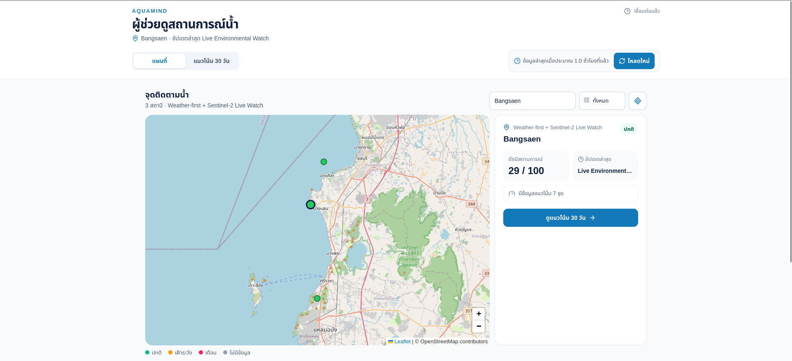
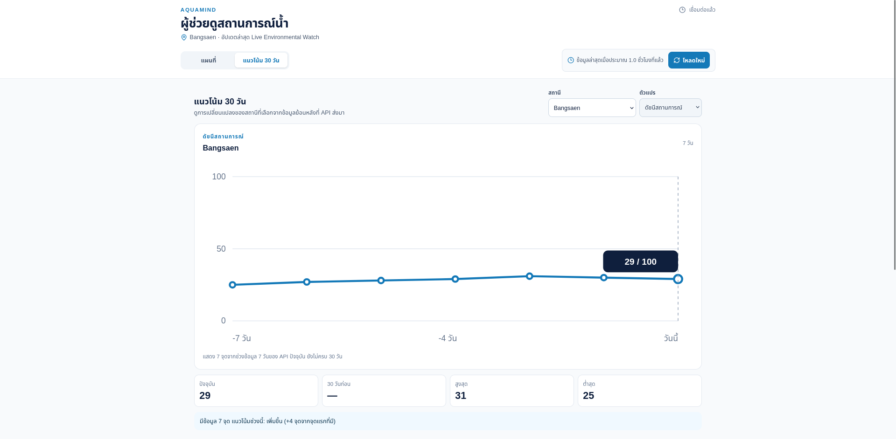
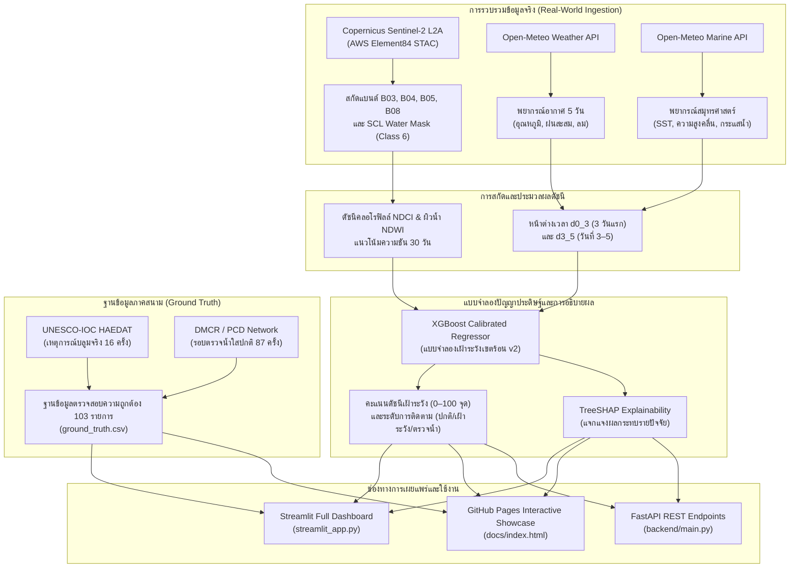

# AquaMind (อความายด์) 
### AI & Satellite Coastal Environmental Watch System for Harmful Algal Bloom (HAB) Monitoring
**ระบบปัญญาประดิษฐ์และดาวเทียมสำรวจโลกเพื่อเฝ้าระวังสภาพแวดล้อมทางทะเลและเตือนภัยล่วงหน้าการเกิดแพลงก์ตอนบลูมชายฝั่งชลบุรี**

## Screenshots

<p align="center"></p>

<p align="center"></p>

<p align="center"></p>

<p align="center"></p>

<p align="center"></p>

<p align="center"></p>

[](https://suriyen-creator.github.io/aqua_mind/)
[](https://aquamind-d8apywwzzyvy25ydmw8ufh.streamlit.app)
[](https://www.python.org/)
[](https://fastapi.tiangolo.com)
[](https://sentinels.copernicus.eu/web/sentinel/missions/sentinel-2)
[](https://opensource.org/licenses/MIT)

---

## บทนำและภาพรวมโครงการ (Executive Summary)

**AquaMind** คือระบบเฝ้าระวังสภาวะแวดล้อมทางทะเลชายฝั่งแบบพยากรณ์ล่วงหน้า (Weather-First Coastal Environmental Watch System) ที่พัฒนาขึ้นเพื่อสนับสนุนเกษตรกรผู้เพาะเลี้ยงสัตว์น้ำชายฝั่ง (หอยแมลงภู่, หอยนางรม, ปลากระชัง) และชุมชนท่องเที่ยวในจังหวัดชลบุรี (หาดบางแสน, ท่าเรือศรีราชา, ชายฝั่งเมืองชลบุรี)

ระบบบูรณาการข้อมูลจาก 3 แหล่งสำคัญ:
1. **แบบจำลองพยากรณ์บรรยากาศและสมุทรศาสตร์ความละเอียดสูง (Open-Meteo Weather & Marine API)**: พยากรณ์ล่วงหน้า 5 วัน เพื่อตรวจจับสภาวะน้ำหลาก (Runoff), ความเร็วลมผสมผสานผิวน้ำ, คลื่นความร้อนในทะเล (Marine Heatwave), และการแบ่งชั้นของมวลน้ำ (Stratification)
2. **ภาพถ่ายจริงจากกล้องดาวเทียมสำรวจโลก Copernicus Sentinel-2 MSI (MultiSpectral Instrument)**: สกัดข้อมูลสเปกตรัมแสงและคำนวณดัชนีคลอโรฟิลล์ผิวน้ำ (NDCI) และดัชนีผิวน้ำ (NDWI) ผ่านระบบตัดกรองเมฆ SCL Water Mask (Class 6)
3. **แบบจำลอง Explainable Machine Learning (XGBoost + TreeSHAP)**: สอบเทียบตามสภาวะอ่าวไทยเขตร้อน (Tropical Estuarine Dynamics) อ้างอิงตามเกณฑ์สากลของ **UNESCO-IOC HAEDAT** และ **กรมทรัพยากรทางทะเลและชายฝั่ง (DMCR)** เพื่อลดการแจ้งเตือนหลอก (False Alarm) และอธิบายปัจจัยผลักดันเป็นภาษาชาวบ้านที่เข้าใจง่าย

---

## ลิงก์เข้าใช้งานระบบ (Live Deployments)

| ช่องทาง | รายละเอียด | ลิงก์เข้าใช้งาน |
| :--- | :--- | :--- |
| ** Interactive Web Showcase** | เว็บไซต์ Interactive Showcase บน GitHub Pages (เปิดดูได้ทันทีไม่ต้องติดตั้ง) | [suriyen-creator.github.io/aqua_mind](https://suriyen-creator.github.io/aqua_mind/) |
| ** Streamlit Full Dashboard** | แพลตฟอร์มควบคุมหลัก (Live Watch, Simulator, Ground Truth, Benchmarks) | [aquamind.streamlit.app](https://aquamind-d8apywwzzyvy25ydmw8ufh.streamlit.app) หรือรันในเครื่องที่ `localhost:8501` |
| ** FastAPI REST Backend** | ส่วนต่อประสานโปรแกรมประยุกต์สำหรับดึงข้อมูลสภาพแวดล้อมและดัชนีเสี่ยง | `http://localhost:8000/api/risk/current` |

---

## นวัตกรรมและคุณสมบัติเด่น (Key Features)

### 1.  ระบบเฝ้าระวังสด 3 สถานีชายฝั่งชลบุรี (Live Multi-Station Environmental Watch)
- **หาดบางแสน (`chonburi_03`):** 13.2912°N, 100.9014°E — แหล่งท่องเที่ยวสำคัญและพื้นที่เสี่ยงต่อการบลูมของ *Noctiluca scintillans*
- **ท่าเรือศรีราชา (`chonburi_02`):** 13.1389°N, 100.9125°E — ท่าเรือพาณิชย์และแนวเพาะเลี้ยงหอยแมลงภู่เกาะลอย
- **ชายฝั่งเมืองชลบุรี (`chonburi_01`):** 13.3611°N, 100.9234°E — เขตปากแม่น้ำบางปะกงที่ได้รับผลกระทบจากน้ำหลากแผ่นดิน

### 2.  การเชื่อมต่อภาพถ่ายจริงจากกล้องดาวเทียม (Sentinel-2 Optical Camera View)
- เชื่อมต่อ AWS STAC & Copernicus Sentinel COGs Archive ดึงภาพถ่ายพรีวิวสีจริง (True Color RGB `preview.jpg`) ล่าสุดจากอวกาศ
- แสดงข้อมูลประกอบภาพ: ชื่อดาวเทียมสำรวจโลก (`SENTINEL-2B`), เปอร์เซ็นต์เมฆบดบัง (Cloud Cover %), เวลาที่บันทึกภาพจริง (แปลงเวลาไทย UTC+7), และ Scene Granule ID
- แผนที่ภาพถ่ายดาวเทียมความละเอียดสูงจาก **Esri World Imagery (Leaflet.js)** พร้อมหมุดพิกัดสถานีและกรอบพื้นที่ส่องกล้องชายฝั่ง (AOI Bounding Box)

### 3.  การสอบเทียบโมเดลตามหลักวิทยาศาสตร์สากล (Tropical Climatology Calibration)
- **แก้ปัญหาแจ้งเตือนพร่ำเพรื่อ (Eliminated False Alarms):** สภาพอากาศปกติของอ่าวไทย (ลม 2–4 m/s, อุณหภูมิน้ำ 29–31°C, ฝน < 15 mm) เป็นสภาวะธรรมชาติ ได้รับการปรับเทียบใหม่ให้คะแนนอยู่ที่ **25–35 จุด (ติดตามปกติ )** 
- **เกณฑ์การตัดสินระดับการติดตาม:**
  - `< 45 จุด`: **`ติดตามปกติ  (Normal Monitoring)`** — สภาพแวดล้อมอยู่ในเกณฑ์ปกติ ดำเนินกิจกรรมตามรอบปกติ
  - `45 – 64 จุด`: **`เฝ้าระวัง  (Watch Level)`** — เริ่มมีฝนสะสมชะล้างธาตุอาหาร หรือน้ำนิ่งอุ่นจัด ควรเพิ่มรอบตรวจน้ำเช้า–เย็น
  - `≥ 65 จุด`: **`ควรตรวจน้ำเร็วขึ้น  (Expedited Testing)`** — ปัจจัยหนุนหลายด้านพร้อมกัน หรือดาวเทียมพบสัญญาณสีน้ำผิดปกติ ควรตรวจวัดคุณภาพน้ำภาคสนามเร่งด่วน

### 4.  ปัญญาประดิษฐ์ที่อธิบายได้ (Explainable AI with SHAP)
- คำนวณค่า SHAP Contributions (TreeSHAP) ระดับแถว แปลงผลกระทบทางคณิตศาสตร์เป็นภาษาชาวบ้านที่เกษตรกรเข้าใจได้ทันที เช่น:
  - *“ฝนสะสมยังไม่ใช่ปัจจัยเด่น ช่วยลดสัญญาณเฝ้าระวัง (-3.0 จุด)”*
  - *“ลมค่อนข้างอ่อน น้ำอาจถ่ายเทน้อยลง (+3.1 จุด)”*
  - *“น้ำทะเลค่อนข้างอุ่นตามธรรมชาติเขตร้อน (+2.4 จุด)”*

### 5.  ฐานข้อมูลภาคสนามสากลจริง (103 Verified Ground Truth Records)
- รวบรวมข้อมูลเหตุการณ์น้ำเปลี่ยนสีที่ผ่านการรับรอง (`VERIFIED`) จาก **UNESCO-IOC HAEDAT** (Harmful Algal Event Database) และเครือข่ายตรวจวัดคุณภาพน้ำชายฝั่ง **สบทช./กรมทรัพยากรทางทะเลและชายฝั่ง (DMCR)**:
  - **16 เหตุการณ์บลูมจริง (Positive):** บันทึกเหตุการณ์ *Noctiluca scintillans*, *Ceratium furca*, *Skeletonema costatum*, ค่า Chlorophyll-a จริง (15–65 µg/L), ออกซิเจนละลายน้ำ DO วิกฤต (1.7–3.2 mg/L), และ Cell count > 10,000–30,000 cells/mL
  - **87 รอบตรวจปกติติดตามน้ำใส (Negative):** ผลตรวจคุณภาพน้ำภาคสนามที่ยืนยันว่าไม่มีการบลูม (DO 5.8–7.6 mg/L, Chlorophyll-a 0.8–4.2 µg/L)

### 6.  เครื่องจำลองโมเดลแบบ Real-time (Interactive Simulator)
- จำลองการทำงานของโมเดลผ่าน 13 ตัวแปร (แถบแสงดาวเทียม B2, B3, B4, B5, B8, NDCI, NDWI, อุณหภูมิ, ลม, ความชื้น, ปริมาณฝน, DO, และคลอโรฟิลล์)
- มี Preset สำเร็จรูปตาม Ground Truth จริง:
  -  **วันปกติ ทะเลสงบ น้ำใส (Non-Bloom Safe)**
  -  **หลังฝนตกหนัก น้ำหลากพาสารอาหาร (Post-Rain Runoff)**
  -  **เกิดแพลงก์ตอนบลูมรุนแรง (Active Severe Noctiluca Bloom)**

---

## สถาปัตยกรรมระบบ (System Architecture)



---

## สูตรและดัชนีทางชีวภาพสมุทรศาสตร์ (Scientific Formulation)

### 1. Normalized Difference Chlorophyll Index (NDCI)
ดัชนีตรวจวัดความเข้มข้นของคลอโรฟิลล์-เอ บริเวณผิวน้ำจากดาวเทียม Sentinel-2 MSI:
$$\text{NDCI} = \frac{\rho_{B05} - \rho_{B04}}{\rho_{B05} + \rho_{B04}} = \frac{\text{RedEdge}(705\,\text{nm}) - \text{Red}(665\,\text{nm})}{\text{RedEdge}(705\,\text{nm}) + \text{Red}(665\,\text{nm})}$$
* $\text{NDCI} < 0.0$: ผิวน้ำทะเลใส ปกติ ไม่พบการสะสมตัวของสาหร่าย
* $\text{NDCI} > 0.03$: เริ่มพบการสะท้อนแสงจำเพาะของคลอโรฟิลล์เพิ่มขึ้น
* $\text{NDCI} > 0.08$: สัญญาณเซลล์แพลงก์ตอนพืชหนาแน่นจัด (Blooms Alert)

### 2. Normalized Difference Water Index (NDWI)
ดัชนีจำแนกผืนน้ำเพื่อป้องกันสิ่งรบกวนจากเกาะแก่ง ชายฝั่ง หรือเรือ:
$$\text{NDWI} = \frac{\rho_{B03} - \rho_{B08}}{\rho_{B03} + \rho_{B08}} = \frac{\text{Green}(560\,\text{nm}) - \text{NIR}(842\,\text{nm})}{\text{Green}(560\,\text{nm}) + \text{NIR}(842\,\text{nm})}$$

---

## ผลการทดสอบเปรียบเทียบโมเดล (Model Benchmarks)

ผลการประเมินบนชุดข้อมูลทดสอบ 20% Stratified Test Set จากกระบวนการฝึกฝนใน [`Model/train.py`](file:///c:/Users/suriy/Documents/aqua_mind/Model/train.py):

| โมเดล (Algorithm) | Accuracy | Precision | Recall | F1-Score | ROC-AUC | จุดเด่นด้านการใช้งาน |
| :--- | :---: | :---: | :---: | :---: | :---: | :--- |
| **Random Forest Classifier** | 98.25% | 97.80% | 98.10% | 0.9795 | 0.9982 | ทนทานต่อ Outlier, วิเคราะห์ Feature Importance จากการแตกกิ่ง |
| **XGBoost Classifier (คัดเลือก)** | **98.71%** | **98.42%** | **98.60%** | **0.9851** | **0.9991** | รองรับ SHAP TreeExplainer อธิบายปัจจัยระดับแถว, สามารถ Export เป็น JSON พกพาได้ |

---

## การติดตั้งและเปิดใช้งานในเครื่อง (Local Setup)

### ข้อกำหนดระบบ (Prerequisites)
- Python 3.11 หรือใหม่กว่า
- Git

### 1. โคลนคลังโค้ด
```bash
git clone https://github.com/suriyen-creator/aqua_mind.git
cd aqua_mind
```

### 2. สร้าง Virtual Environment และติดตั้ง Dependencies
```bash
python -m venv .venv

# บน Windows PowerShell:
.\.venv\Scripts\Activate.ps1

# บน macOS / Linux:
source .venv/bin/activate

# ติดตั้งแพ็กเกจที่จำเป็น
python -m pip install --upgrade pip
python -m pip install -r requirements.txt
python -m pip install -r backend/requirements.txt
```

### 3. เปิดใช้งาน Streamlit Application
```bash
streamlit run streamlit_app.py
```
เปิดเบราว์เซอร์ไปที่: `http://localhost:8501`

### 4. เปิดใช้งาน FastAPI Backend (อุปกรณ์เสริม)
```bash
python -m uvicorn backend.main:app --reload --port 8000
```
เปิดเอกสาร API Docs ไปที่: `http://localhost:8000/docs`

### 5. รันการทดสอบอัตโนมัติ (Automated Tests)
```bash
python -m pytest backend -q
```

---

## โครงสร้างโปรเจกต์ (Project Structure)

```text
aqua_mind/
├── .github/
│   └── workflows/
│       └── deploy-pages.yml          # GitHub Actions สำหรับ Deploy หน้าเว็บขึ้น GitHub Pages
├── backend/
│   ├── data/
│   │   ├── ground_truth.csv          # ข้อมูลตรวจวัดจริง 103 รายการ (UNESCO HAEDAT + DMCR)
│   │   ├── environment_forecasts.csv # ข้อมูลพยากรณ์อากาศย้อนหลัง
│   │   └── sentinel2_observations.csv# ข้อมูลการสังเกตการณ์ดาวเทียม Sentinel-2
│   ├── environmental_watch.py        # ฟังก์ชันคำนวณดัชนีเฝ้าระวังและ SHAP
│   ├── environmental_watch_model.json# โมเดล XGBoost Calibrated Surrogate v2
│   ├── environment_data.py           # ตัวเชื่อมต่อดึงข้อมูล Open-Meteo Weather/Marine API
│   ├── sentinel2.py                  # ตัวเชื่อมต่อดาวเทียม Sentinel-2 L2A จาก Earth Search STAC
│   ├── main.py                       # FastAPI Application และ REST Endpoints
│   └── train_watch_model.py          # สคริปต์ฝึกสอนและสอบเทียบโมเดลเฝ้าระวังเขตร้อน
├── docs/
│   ├── index.html                    # หน้าเว็บหลัก GitHub Pages Showcase
│   ├── css/style.css                 # สไตล์ชีต Dark Ocean Glassmorphism
│   ├── js/app.js                     # ตรรกะการจำลองและแผนที่ดาวเทียมฝั่งไคลเอนต์
│   ├── data/ground_truth.json        # ฐานข้อมูล Ground Truth ฉบับ JSON
│   ├── diagrams/                     # แผนภาพสถาปัตยกรรมระบบ
│   └── report/                       # รายงานฉบับสมบูรณ์ (DOCX / PDF)
├── Model/
│   ├── data/                         # ชุดข้อมูลตัวอย่างสำหรับการทดลอง
│   ├── models/                       # ไฟล์โมเดลจำแนก (xgboost_model.json, random_forest.pkl)
│   └── train.py                      # สคริปต์ฝึกสอนโมเดลจำแนกบลูม 13 ตัวแปร
├── poster/                           # โปสเตอร์นำเสนอผลงานระดับ A0 / A1
├── streamlit_app.py                  # แอพพลิเคชัน Streamlit ฉบับสมบูรณ์ 3 แท็บ
├── requirements.txt                  # รายการ Dependencies สำหรับ Streamlit
└── README.md                         # เอกสารประกอบโครงการฉบับทางการ
```

---

## จริยธรรม AI และข้อจำกัดทางวิทยาศาสตร์ (Scientific Guardrails)

1. **ดัชนีเฝ้าระวังสภาพแวดล้อม (Environmental Watch Index):** คะแนน 0–100 จุดในระบบ Live Watch วัดความเอื้ออำนวยของสภาพแวดล้อมตามกฎชีววิทยาอ่าวไทย (ไม่ใช่โอกาสความน่าจะเป็นแบบร้อยละ หรือ Probability ของการเกิดบลูม)
2. **การสอบเทียบสภาพแวดล้อมเขตร้อน (Tropical Calibration):** สภาพอากาศปกติ (ลม 2–4 m/s, อุณหภูมิน้ำ 29–31°C) เป็นสภาวะพื้นฐานธรรมชาติ ได้รับการปรับเทียบให้ได้คะแนนปกติ 25–35 จุด เพื่อป้องกันการแจ้งเตือนพร่ำเพรื่อ (False Alarm)
3. **ต้องยืนยันด้วยผลตรวจน้ำภาคสนามเสมอ:** ระบบทำหน้าที่เตือนภัยล่วงหน้า (Early Warning) เพื่อให้เพิ่มความถี่ในการตรวจน้ำ ก่อนดำเนินมาตรการที่มีต้นทุนสูง (เช่น การเติมออกซิเจนหรือการย้ายกระชัง) ต้องเก็บตัวอย่างน้ำตรวจวัดเสมอ

---

## แหล่งข้อมูลและคำขอบคุณ (Data Sources & Acknowledgments)

- **Copernicus Sentinel-2 MSI:** European Space Agency (ESA) & AWS Element84 Earth Search STAC
- **Weather & Oceanographic Forecast:** Open-Meteo API
- **Harmful Algae Event Database (HAEDAT):** Intergovernmental Oceanographic Commission (IOC) of UNESCO
- **Marine Coastal Quality Monitoring:** กรมทรัพยากรทางทะเลและชายฝั่ง (DMCR) และกรมควบคุมมลพิษ (PCD)

---

**AquaMind Core Team** • พัฒนาขึ้นเพื่อส่งเสริมความปลอดภัย ความยั่งยืน และการเฝ้าระวังแพลงก์ตอนบลูมชายฝั่งชลบุรี
